I'm a PhD candidate in AI for cybersecurity at the Laboratory of Information Technology and Modeling (LTIM), Faculty of Sciences Ben M'Sick, Hassan II University of Casablanca. My research covers deep learning for security operations, ML-driven SIEM and privacy-preserving exam proctoring, with the code on GitHub.

### Publications

**Integrating Security into Industry 5.0: Challenges, Solutions, and Impacts** 
Book chapter in *Industry 5.0 and Emerging Technologies*, Springer, 2024. [DOI](https://doi.org/10.1007/978-3-031-70996-8_13) 
Maps the security challenges that come with Industry 5.0 and proposes strategies to mitigate them.

**A Next-Generation Deep Learning-Powered Security Operations Center (SOC) for Online Learning Platforms** 
*Proceedings of ELSES 2023*, Atlantis Press, 2023. [DOI](https://doi.org/10.2991/978-94-6463-360-3_29), [code](https://github.com/aliradid/soc-log-anomaly-dl) 
For log anomaly detection, a BI-LSTM with attention reached 0.98 accuracy and 0.97 F1, ahead of a GRU and a CNN.

### Current research

**[OpenSIEM-AI](https://github.com/aliradid/siem-ai)**: open-source SIEM with ML detection and automated SOAR containment, at 1.16&nbsp;s p95 from log ingest to containment over 500 cycles.

**[Privacy-preserving multi-modal proctoring](https://github.com/aliradid/proctoring-privacy)**: YOLOv8, MediaPipe FaceMesh and a content-free Whisper encoder, fused by a random forest to reach F1 0.905 ± 0.041 at 23.7&nbsp;FPS on an Apple M4 Max. No biometric template, raw video or raw audio is ever stored.

### Tools

**[citation-needed](https://github.com/aliradid/citation-needed)**: checks every factual claim in a draft against live sources and returns an evidence ledger. Works in Claude Code, Codex, Cursor, Gemini CLI and other agents.

**[when-in-rome](https://github.com/aliradid/when-in-rome)**: makes agent-written commits and PRs match the repo's own history. Ships as a skill, a git hook and a GitHub Action.

**[jarvis-macos](https://github.com/aliradid/jarvis-macos)**: my native macOS workspace app, built with SwiftUI and AppKit.

### Latest releases

<!-- releases:start -->
- 2026-09-16: [citation-needed v1.0.0](https://github.com/aliradid/citation-needed/releases/tag/v1.0.0)
- 2026-09-16: [when-in-rome v1.1.1](https://github.com/aliradid/when-in-rome/releases/tag/v1.1.1)
<!-- releases:end -->

### Stack

### Contact

Reach me at [ali.radid-etu@etu.univh2c.ma](mailto:ali.radid-etu@etu.univh2c.ma), on [LinkedIn](https://www.linkedin.com/in/aliradid/) or through [Google Scholar](https://scholar.google.com/citations?user=mKYdylMAAAAJ&hl=en).
